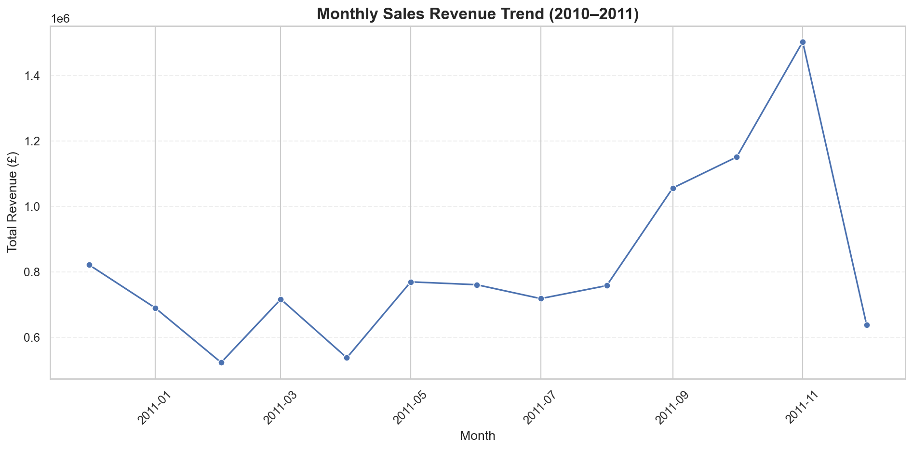
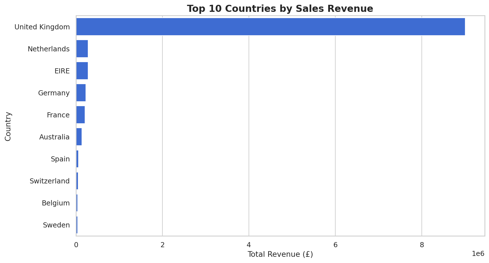

# E-Commerce Sales Analysis & Interactive Dashboard

**End-to-end data analysis with Python, Pandas, Seaborn, Altair, and Streamlit**

This project explores real transaction data from a UK-based online retailer. It covers data quality checks, cleaning, exploratory analysis, business KPIs, and an interactive dashboard that lets users explore sales by date, country, and product.

**[🚀 Open the Live Dashboard](https://sohaib-fp1-ecommerce-analytics.streamlit.app/)** · **[📓 View the Analysis Notebook](ecommerce_sales_analysis_final.ipynb)** · **[📊 GitHub Repository](https://github.com/sohibb9/E-Commerce-Sales-Analysis)**

---

## Project overview

The objective is to turn raw retail transactions into useful business insights and an easy-to-use analytics dashboard. The analysis answers questions such as:

- How much sales revenue did the business generate, and how did it change over time?
- Which countries contributed the most revenue?
- Which products generated the most revenue?
- Who were the highest-spending and most frequent **identified** customers?
- How do sales patterns change when filtering by country or date?

**Dataset:** [Online Retail — UCI Machine Learning Repository](https://archive.ics.uci.edu/dataset/352/online+retail) ([Kaggle CSV mirror](https://www.kaggle.com/datasets/carrie1/ecommerce-data))  
**Period:** December 1, 2010–December 9, 2011  
**Currency:** GBP (£)  
**Original dataset:** 541,909 transaction lines

> **Scope:** The reported KPIs describe *positive-quantity, positive-price, non-cancellation sales after exact duplicate removal*. Revenue is **not** profit, and it does **not** represent full net revenue after returns.

## Results at a glance

Results below use the **full date range and all countries**, matching the cleaned notebook and the dashboard's default filters.

| Metric | Result |
|:---|---:|
| **Total sales revenue** | **£10,642,110.80** |
| **Distinct orders** | **19,960** |
| **Known customers** | **4,338** |
| **Average order value (AOV)** | **£533.17** |
| **Sales rows after cleaning** | **524,878** |
| **Unique stock codes** | **3,922** |

**Metric definitions**

- **Revenue:** Sum of `Quantity × UnitPrice` for retained sales rows.
- **Orders:** Number of unique `InvoiceNo` values, not the number of individual line items.
- **Known customers:** Unique, non-missing `CustomerID` values; missing customer IDs remain in revenue and order calculations.
- **AOV:** Total sales revenue / distinct orders.
- **Unique stock codes:** Includes some non-product/service codes; these are handled separately in product rankings.

## Key findings

- **The United Kingdom dominates revenue**, contributing approximately **84.6%** of the analyzed sales total.
- **November 2011** had the highest monthly revenue among the complete months covered, at approximately **£1.50 million**.
- The top product description by revenue was **REGENCY CAKESTAND 3 TIER**, generating approximately **£174,156.54** under the product-ranking rules.
- Customer value and customer frequency are different measures: top spenders are not necessarily the customers who placed the most orders.
- The data ends on **December 9, 2011**. December 2011 is incomplete, so its monthly total should not be compared directly with a full month.

### Sample analysis charts

The notebook produces six figures in the [`figures/`](figures/) directory. Here are two examples:

**Monthly revenue trend**



**Top countries by revenue**



For interactive visualizations and filters, use the **[live dashboard](https://sohaib-fp1-ecommerce-analytics.streamlit.app/)**.

## Interactive dashboard

The Streamlit dashboard provides:

- **Four live KPIs:** revenue, orders, known customers, and AOV.
- **Country and date filters** that update the KPIs and charts together. An empty country selection means all countries.
- **Monthly revenue trend** and **top 10 countries by revenue**, presented in balanced, side-by-side charts.
- **Top 10 products by revenue**, with a ranking table on the left and a horizontal bar chart on the right.
- **Dataset preview and methodology notes** in a collapsible section.
- **Responsive Altair charts** without mouse-wheel zoom, plus a static product table to avoid nested scrolling.

**Live app:** https://sohaib-fp1-ecommerce-analytics.streamlit.app/

## Data preparation and analytical assumptions

The cleaning and transformation steps are documented in [`ecommerce_sales_analysis_final.ipynb`](ecommerce_sales_analysis_final.ipynb).

1. **Filter sales:** Exclude invoice IDs beginning with `C` (cancellations), `Quantity <= 0`, and `UnitPrice <= 0`.
2. **Calculate line revenue:** `TotalPrice = Quantity * UnitPrice`.
3. **Remove exact duplicate rows:** Remove **5,226** duplicate copies from the sales-only data. This reduces calculated sales revenue by **£24,573.74** (approximately **0.23%**). Identical transaction lines are not necessarily data-entry errors, so this is an explicit analytical assumption.
4. **Handle missing customer IDs:** Keep **132,186** rows with missing `CustomerID` in sales totals; exclude their missing IDs from customer-level counts and rankings only.
5. **Distinguish products from fees/services:** Exclude `DOT`, `POST`, and `M` from product rankings, but retain their values in overall revenue. Other special codes may still exist.
6. **Preserve invoice identifiers as strings:** This avoids inconsistent counts caused by mixed numeric/text parsing of `InvoiceNo`.
7. **Export the dashboard dataset:** Save a compressed `sales_dashboard.csv.gz` with replaced invoice and customer identifiers. The original cleaned notebook data remains separate.

The dashboard is a **descriptive sales analysis**, not a profitability model. Costs, margins, and full refund accounting are not available here.

## Technology stack

| Tool | Purpose |
|:---|:---|
| Python | Data processing and application logic |
| Pandas | Cleaning, grouping, KPI calculations, and filtering |
| Matplotlib & Seaborn | Exploratory analysis and saved notebook charts |
| Altair | Interactive dashboard visualizations |
| Streamlit | Web dashboard and user-facing filters |
| Jupyter Notebook | Reproducible analysis and documented decisions |
| Git & GitHub | Version control and project hosting |
| Streamlit Community Cloud | Live app hosting |

## Project structure

```text
E-Commerce-Sales-Analysis/
├── app.py                             # Streamlit dashboard
├── dashboard_utils.py                 # Data loading, validation, and KPIs
├── ecommerce_sales_analysis_final.ipynb
├── sales_dashboard.csv.gz             # Compressed dashboard data extract
├── figures/                           # Six charts generated by the notebook
│   ├── monthly_revenue_trend.png
│   ├── monthly_order_volume.png
│   ├── top_countries_revenue.png
│   ├── top_products_revenue.png
│   ├── top_customers_spending.png
│   └── top_customers_frequency.png
├── tests/
│   └── smoke_test.py                  # Data, KPI, and aggregation checks
├── requirements.txt
├── .gitignore
└── README.md
```

Local-only files such as `data.csv`, `sales_cleaned.csv`, `Backup/`, and `.venv/` are intentionally not tracked in this repository.

## Run the dashboard locally

**Requirements:** Python 3.11 or newer, with Git optional if you download the repository as a ZIP.

```bash
git clone https://github.com/sohibb9/E-Commerce-Sales-Analysis.git
cd E-Commerce-Sales-Analysis
python -m venv .venv
```

Activate the environment:

**Windows CMD:**

```cmd
.venv\Scripts\activate
```

**macOS / Linux:**

```bash
source .venv/bin/activate
```

Install dependencies and start the dashboard:

```bash
python -m pip install -r requirements.txt
python -m streamlit run app.py
```

The app usually opens at **http://localhost:8501**. It uses the included `sales_dashboard.csv.gz`, so **you do not need to download the raw CSV just to run the dashboard**.

### Run the smoke test

```bash
python tests/smoke_test.py
```

Expected test summary:

```text
PASS: dataset, privacy checks, KPIs, filters, charts and aggregations
Revenue £10,642,110.80; 19,960 orders; 4,338 customers
```

This test checks the data extract, identifier format, core KPIs, filtering, and aggregation results; it is **not** an automated browser/UI test.

## Reproduce the notebook analysis

The Streamlit app and the notebook have different input requirements.

1. Download the original `data.csv` from the [Kaggle CSV mirror](https://www.kaggle.com/datasets/carrie1/ecommerce-data). The [UCI source](https://archive.ics.uci.edu/dataset/352/online+retail) distributes the original data as an Excel file; if using UCI directly, convert it to the expected CSV schema first.
2. Put `data.csv` at the **root of this project**, next to the notebook.
3. Open [`ecommerce_sales_analysis_final.ipynb`](ecommerce_sales_analysis_final.ipynb) in Jupyter or VS Code and run its cells in order **from the project root**.
4. The notebook performs cleaning, creates KPIs and analysis charts, exports `sales_dashboard.csv.gz`, and validates the export.
5. Run the smoke test to verify the data used by the dashboard.

The notebook regenerates **random pseudonymous identifiers** during export. This can change the compressed file's binary contents even when its revenue, order, and customer totals remain identical.

## Deployment and updates

The dashboard is deployed on **[Streamlit Community Cloud](https://share.streamlit.io/)** from this repository's `main` branch, using `app.py` as the entry point.

To publish future changes after reviewing them locally:

```bash
git status
git add app.py dashboard_utils.py ecommerce_sales_analysis_final.ipynb README.md requirements.txt .gitignore figures/ tests/ sales_dashboard.csv.gz
git commit -m "Update e-commerce analysis and dashboard"
git push
```

Updates pushed to the connected branch normally trigger a Streamlit app redeployment. Changing only the README updates the GitHub project page and does not change the dashboard's appearance.

## Data source, attribution, and privacy

**Original dataset citation:**  
Chen, D. (2015). *Online Retail* [Dataset]. UCI Machine Learning Repository. https://doi.org/10.24432/C5BW33

The [UCI dataset page](https://archive.ics.uci.edu/dataset/352/online+retail) lists a **Creative Commons Attribution 4.0 International (CC BY 4.0)** license. The data used here is derived from the original dataset by filtering sales, dropping exact duplicates, calculating line revenue, selecting columns, and replacing invoice/customer identifiers.

The published extract uses **pseudonymization, not guaranteed anonymization**: detailed transactions could potentially be matched against the original public dataset. Do not apply the same sharing approach to private customer or client data without a separate privacy and permissions review.

---

**Project by [Sohaib Mohamed](https://github.com/sohibb9)** · [GitHub repository](https://github.com/sohibb9/E-Commerce-Sales-Analysis) · [Live dashboard](https://sohaib-fp1-ecommerce-analytics.streamlit.app/)
